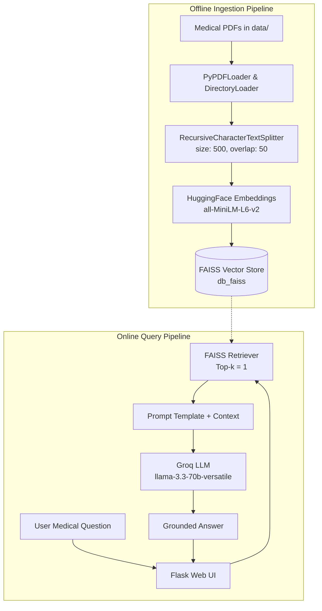

# 🩺 Medical AI Assistant

[](https://www.python.org/)
[](https://flask.palletsprojects.com/)
[](https://www.langchain.com/)
[-orange.svg)](https://groq.com/)
[](https://github.com/facebookresearch/faiss)
[](https://huggingface.co/)
[](https://opensource.org/licenses/MIT)

An intelligent, context-aware **Medical Q&A Chatbot** powered by **Retrieval-Augmented Generation (RAG)**. The assistant ingests medical literature in PDF format, indexes semantic representations into a high-performance **FAISS** vector store, and utilizes **Llama 3.3 70B** (via **Groq**) to deliver concise, verified answers grounded strictly in retrieved medical sources.

---

## 📑 Table of Contents

- [Overview](#-overview)
- [Architecture & Workflow](#-architecture--workflow)
- [Key Features](#-key-features)
- [Tech Stack](#-tech-stack)
- [Project Structure](#-project-structure)
- [Getting Started](#-getting-started)
  - [Prerequisites](#prerequisites)
  - [Installation](#installation)
  - [Configuration (.env)](#configuration-env)
- [Usage Guide](#-usage-guide)
  - [1. Data Ingestion & Vector Indexing](#1-data-ingestion--vector-indexing)
  - [2. Launching the Web Application](#2-launching-the-web-application)
- [Configuration Details](#-configuration-details)
- [Disclaimer](#-medical-disclaimer)
- [License](#-license)

---

## 🔬 Overview

Traditional LLMs may hallucinate or provide overly broad medical opinions. This application implements a strict **Retrieval-Augmented Generation (RAG)** pipeline:
1. **Document Loading & Chunking:** Extracts knowledge from curated medical textbooks and research PDFs using character splitting.
2. **Dense Vector Embeddings:** Encodes text segments with the `sentence-transformers/all-MiniLM-L6-v2` model from Hugging Face.
3. **Similarity Retrieval:** Indexes vectors with Facebook AI Similarity Search (**FAISS**) for rapid semantic nearest-neighbor retrieval.
4. **Constrained Generation:** Uses **Llama-3.3-70b-versatile** via **Groq**'s ultra-fast inference engine, enforced by custom prompt templates restricting answers to 2–3 accurate lines using *only* verified context.

---

## 🏗 Architecture & Workflow



---

## ✨ Key Features

- **⚡ Blazing-Fast Inference:** Powered by Groq LPU™ technology running Meta's `llama-3.3-70b-versatile`.
- **🎯 Hallucination Minimization:** Specially crafted system prompts prohibit speculation and force the model to answer solely using supplied literature.
- **📚 Dynamic PDF Knowledge Base:** Drop any medical PDF textbook or guide into `data/` and build your vector store with a single command.
- **💾 Local Vector Storage:** Employs local FAISS index serialization—no external vector database subscription needed.
- **💻 Minimalist & Clean Web UI:** Flask-driven interface featuring chat session memory, formatted responses, and an instant conversation reset option.
- **🛡 Robust Architecture:** Modular design with centralized logging and custom exception handling across all components.

---

## 🛠 Tech Stack

| Component | Technology | Description |
|---|---|---|
| **Language** | Python 3.10+ | Core development |
| **Web Framework** | Flask | Web server & route handling |
| **Framework / RAG** | LangChain (`0.3.x`) | RAG pipeline orchestration |
| **LLM Provider** | Groq Cloud | Ultra-low latency LLM inference |
| **LLM Model** | `llama-3.3-70b-versatile` | 70-billion parameter reasoning model |
| **Embeddings** | Hugging Face (`all-MiniLM-L6-v2`) | Compact, high-efficiency dense vectors |
| **Vector Database** | FAISS (faiss-cpu) | High-speed local similarity search |
| **Document Parser** | PyPDF / LangChain DirectoryLoader | PDF document reading and chunking |

---

## 📁 Project Structure

```plaintext
Medical-AI-Assistant/
├── app/
│   ├── common/
│   │   ├── __init__.py
│   │   ├── custom_exception.py      # Custom exception wrapper with traceback logging
│   │   └── logger.py                # Centralized timestamped file & console logging
│   ├── components/
│   │   ├── __init__.py
│   │   ├── data_loader.py           # Pipeline runner to parse PDFs & save vector store
│   │   ├── embeddings.py            # HuggingFace embedding model loader
│   │   ├── llm.py                   # Groq LLM client initialization
│   │   ├── load_pdf.py              # PDF extraction & text chunking logic
│   │   ├── retriverer.py            # RetrievalQA chain & custom prompt template
│   │   └── vector_store.py          # FAISS index persistence and loading
│   ├── config/
│   │   ├── __init__.py
│   │   └── config.py                # Paths, chunk sizes, and API configurations
│   ├── templates/
│   │   └── index.html               # Responsive chatbot web interface
│   ├── __init__.py
│   └── application.py               # Flask application entry point
├── data/                            # Directory for medical PDF documents (git-ignored)
├── vectorstore/                     # Local FAISS index files (git-ignored)
├── logs/                            # Application run logs (git-ignored)
├── .env                             # Environment variables & secrets (git-ignored)
├── .gitignore                       # Git ignore configuration
├── req.txt                          # Project dependencies
├── setup.py                         # Package build configuration
└── README.md                        # Documentation
```

---

## 🚀 Getting Started

### Prerequisites

- **Python**: Version `3.10` or higher
- **Groq API Key**: Get a free API key at [console.groq.com](https://console.groq.com/)
- **Git**

### Installation

1. **Clone the repository:**
   ```bash
   git clone https://github.com/your-username/medical-ai-assistant.git
   cd medical-ai-assistant
   ```

2. **Create and activate a virtual environment:**
   - **Linux / macOS:**
     ```bash
     python3 -m venv venv
     source venv/bin/activate
     ```
   - **Windows (PowerShell):**
     ```powershell
     python -m venv venv
     venv\Scripts\Activate.ps1
     ```

3. **Install dependencies:**
   ```bash
   pip install -r req.txt
   ```

4. **Install project in editable mode:**
   ```bash
   pip install -e .
   ```

---

### Configuration (.env)

Create a `.env` file in the project root directory and add your Groq API credentials:

```ini
Groq_API_KEY=your_groq_api_key_here
```

> 💡 **Note:** Ensure `.env` is never committed to GitHub. It is already added to `.gitignore`.

---

## 📖 Usage Guide

### 1. Data Ingestion & Vector Indexing

1. Place one or more medical PDF documents inside the `data/` folder at the root of the project:
   ```bash
   mkdir -p data
   # Copy your medical PDF file(s) into data/
   ```
   *(Example: `data/The_GALE_ENCYCLOPEDIA_of_MEDICINE.pdf`)*

2. Run the data loader script to process PDFs and build the FAISS index:
   ```bash
   python -m app.components.data_loader
   ```
   This will:
   - Extract text from all PDFs in `data/`
   - Split content into manageable chunks (500 chars with 50 overlap)
   - Compute Hugging Face dense embeddings
   - Save the serialized FAISS vector store to `vectorstore/db_faiss/`

---

### 2. Launching the Web Application

Start the Flask server:

```bash
python app/application.py
```

Once running, navigate to the local server in your browser:

```text
http://localhost:5000
```

- Type your medical query in the prompt box and click **Send**.
- Click **Clear Chat** at any time to wipe the conversation history for that session.

---

## ⚙️ Configuration Details

You can modify chunking parameters, paths, and model settings in `app/config/config.py`:

```python
GROQ_API_KEY = os.environ.get("Groq_API_KEY")
DB_FAISS_PATH = "vectorstore/db_faiss"
DATA_PATH = "data/"

CHUNK_SIZE = 500       # Size of text segments in characters
CHUNK_OVERLAP = 50     # Overlap between segments to preserve context
```

To switch the LLM model or parameters, modify `app/components/llm.py`:
- **Default model:** `llama-3.3-70b-versatile`
- **Temperature:** `0.7`
- **Max tokens:** `250`

---

## ⚠️ Medical Disclaimer

> **IMPORTANT:**
> This software is intended strictly for **educational and informational purposes**. It is not designed or intended for use in the diagnosis, cure, mitigation, treatment, or prevention of any disease or health condition, nor as a substitute for professional medical judgment, advice, or care. Always consult a qualified healthcare provider for any medical decisions.

---

## 📄 License

This project is open-source and licensed under the [MIT License](LICENSE).
